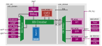

# manquehue_chip

This repository builds `croc_soc`, a small RISC-V system on chip, as a hard macro for the GlobalFoundries GF180MCU
5 V process. The flow uses Synopsys Fusion Compiler (FC) and the Synopsys sign-off tools. The design is croc, an
educational SoC of the PULP Platform. We added parts for an acoustic sensor node: an SPI interface for an ADC and a
LoRa radio, an FFT accelerator and boot from a QSPI flash.

The AC3E chip puts `croc_soc` on a 108-pad ring, next to the DC-DC blocks. That chip is built in
[waferspace_manquehue](https://github.com/nic0villegasc/waferspace_manquehue) and goes on a wafer.space GF180MCU
shuttle.



*`croc_soc` has two parts: `croc_domain` (CVE2 core, debug, peripherals, SRAM) and `user_domain` (SPI for the ADC and
the radio, FFT, QSPI flash). The wake input of the AFE board (`afe_irq_i`) goes to the ADC reader of the SPI
block.*

## Quick start

```
make help                 # the main targets (make help-all: all targets)
make sim                  # croc in Verilator with a program (BIN=<hex>, default helloworld)
make regress              # RTL block test benches and the ZedBoard bring-up steps
make all                  # the six FC steps: outputs/croc_soc_<timestamp>/ (outputs/latest is the newest)
make signoff check        # all checks of the newest run (RUN=<run> for another run)
make release              # the release files of a run, after all checks PASS
make fpga                 # the ZedBoard bitstream (Vivado)
```

## Where things are

| Folder | Contents |
|---|---|
| `rtl/` | croc RTL, the vendored IPs, `user_domain/`, the FPGA top |
| `config/` | corners, libraries and clocks: one place for the flow, the checks and the scripts |
| `flists/` | file lists for FC, simulation and FPGA |
| `scripts/` | the FC steps `01_read_rtl` to `06_finish`, then one folder per stage: `signoff/`, `sim/`, `fpga/`, `release/` |
| `sim/` | test benches (`tb/`), models, firmware (`sw/`, one library in `sw/lib/`), FFT reference |
| `work/`, `outputs/` | FC library and tool files, the runs and their check results (not in git) |

Each stage folder has a short README. A check writes `outputs/<run>/checks/<check>/summary.txt`, and `make report`
collects them in `outputs/<run>/report.md`.

## Tools

- Synopsys Fusion Compiler and Library Manager, with the Synopsys technology data of GF180MCU.
- Sign-off: PrimeTime, Formality, TestMAX ATPG, VCS. Optional: IC Validator, PrimePower, RedHawk-SC.
- The open GF180MCU PDK (gf180mcuD, installed with ciel), KLayout and the GF180MCU DRC and LVS decks.
- Simulation: Verilator 5, Icarus Verilog and a RISC-V GCC (`riscv32-none-elf-`) for the firmware.

## Setup

- `TECHLIB_DATA_DIR` in `scripts/impl/lib/setup.tcl`: the Synopsys technology data (NDM libraries, tech file, GDS).
- `scripts/utils/env.sh`: the tool and PDK paths. Put your own values in `scripts/utils/local.env` (not in git).

## Credits

Nicolás Villegas, Universidad de los Andes, Chile, with AC3E and Synopsys. The croc SoC is from ETH Zurich and the
University of Bologna ([pulp-platform/croc](https://github.com/pulp-platform/croc)). The base of the FC flow is from
W. Shepherd Pitts (NCSU) and Viktor Schneider (IMS LUH).
