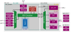

# manquehue_chip

This repository implements a small RISC-V system on chip for the GlobalFoundries GF180MCU 5 V process, with
Synopsys Fusion Compiler (FC). The design is croc (`croc_soc`), an educational SoC from the PULP Platform, with
additions for an acoustic sensor node: an SPI interface for an ADC and a LoRa radio, an FFT accelerator, and boot
from a QSPI flash.

The flow builds `croc_soc` as a hard macro, and it also builds the whole chip: `croc_soc` on the 108-pad ring of the
AC3E chip, next to the DC-DC converter blocks of the same die. The chip goes on a wafer.space GF180MCU shuttle.



*`croc_soc` has two parts: `croc_domain` (CVE2 core, debug, peripherals, SRAM) and `user_domain` (SPI for the ADC and
the radio, FFT, QSPI flash). PD_CORE and PD_MEM show the power domains of the power-gating study. The implementation
has one supply.*

## Layout

| Folder | Contents |
|---|---|
| `rtl/` | croc RTL, vendored IPs, `user_domain/`, test benches in `rtl/test/` |
| `rtl/chip/` | `chip_top.sv`, the chip netlist top (generated) |
| `flists/` | file lists for FC, simulation and FPGA |
| `scripts/` | FC steps `01_read_rtl` to `06_finish`, then `common/` (macro and chip), `chip/` (chip mode), `waferspace/` (macro into the wafer.space template), `dft/`, `signoff/`, `sim/`, `utils/`, `fpga/` |
| `sim/` | test benches, models, firmware (`sw/`), FFT reference, experiments |
| `docs/` | the architecture diagram |
| `work/`, `outputs/` | FC library and logs, exported runs (not in git) |

## Tools

- Synopsys Fusion Compiler and its Library Manager (`fc_shell`, `lm_shell`), with the Synopsys technology data of
  GF180MCU.
- The open GF180MCU PDK (gf180mcuD, installed with ciel), KLayout, and the GF180MCU DRC and LVS decks.
- For sign-off: PrimeTime, Formality, IC Validator (optional), TestMAX ATPG, RedHawk-SC (optional).
- For simulation: Verilator, Icarus Verilog, and a RISC-V GCC for the firmware.
- For the chip precheck: the [wafer.space project template](https://github.com/wafer-space/gf180mcu-project-template)
  (LibreLane, nix) and [gf180mcu-precheck](https://github.com/wafer-space/gf180mcu-precheck).

## Setup

Set the paths for your machine:

- `TECHLIB_DATA_DIR` in `scripts/common/setup.tcl`: the Synopsys technology data (NDM libraries, tech file, GDS).
- `PDK_ROOT`, `TEMPLATE_DIR` and `PRECHECK_DIR` in `scripts/utils/env.sh`: the open PDK, the wafer.space template
  and the precheck.

`outputs/.cache` holds the SRAM timing that the flow makes on the first run. Copy it into a new worktree.

## Macro (croc_soc)

```
make all                  # 01_read_rtl to 06_finish
make floorplan            # or one step: read_rtl, floorplan, synthesis, cts, route, finish
make gui_floorplan        # open a step in the GUI
```

Each run goes to `outputs/croc_soc_<timestamp>/` (GDS, netlist, LEF, blackbox, SDC, SPEF, reports), and
`outputs/latest` points at the newest run. `CROC_MACRO_SIZE` and `CROC_MACRO_LL` in `setup.tcl` set the outline of
the macro and its position in the chip. The pins face their pads in `scripts/chip/padring.txt`.

## Chip (CHIP_FLOORPLAN=1)

Chip mode builds the whole die: `croc_soc` on the CROC pads of the AC3E ring, the wafer.space IPs, and the DC-DC
wrappers at their drawn positions. The wrapper GDS come from `DCDC_GDS_DIR`. `scripts/chip/padring.txt` holds the pad
ring: the pads, the breakers and the supply segments.

```
make chip_macros_ndm      # once: wafer.space IPs, DC-DC abstracts, IO library
make chip_pnr             # chip_top.sv from padring.txt, then 01 to 06 in work/chip.dlib
make chip_finish          # seal ring and the wafer.space precheck (FILL=1: also a filled GDS)
make chip_gui             # open a chip block (BLOCK=floorplan, route, ...)
```

Outputs: `outputs/chip_floorplan/`, `chip_route/`, `chip_final/` (GDS, DEF, netlist) and `chip_finish/` (precheck).

## Checks and simulation

```
make signoff              # DRC, LVS, PrimeTime STA, equivalence of a macro run (RUN=<run>, default latest)
make check                # scan STA, gate-level simulation, DFT/ATPG, the macro in the wafer.space template, report
make sim                  # croc on Verilator with a program (BIN=<hex>)
make sim-spi              # SPI block test bench
make help                 # every target and option
```

`sim/GLS.md` describes the gate-level simulation.

## Credits

Nicolás Villegas, Universidad de los Andes, Chile, with AC3E and Synopsys. The croc SoC is from ETH Zurich and the
University of Bologna ([pulp-platform/croc](https://github.com/pulp-platform/croc)). The base of the FC flow is from
W. Shepherd Pitts (NCSU) and Viktor Schneider (IMS LUH).
